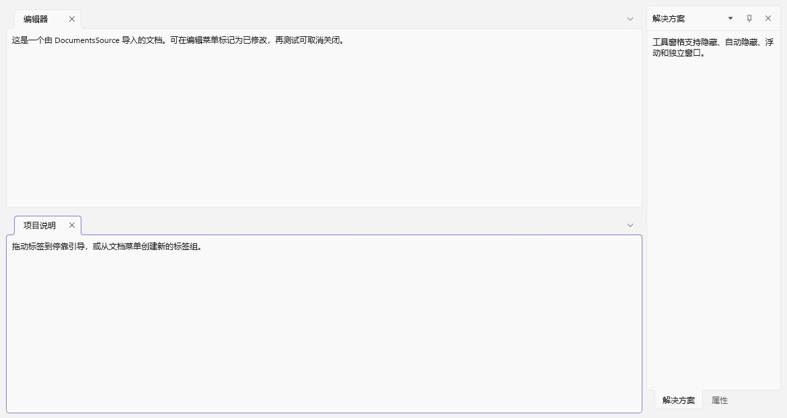
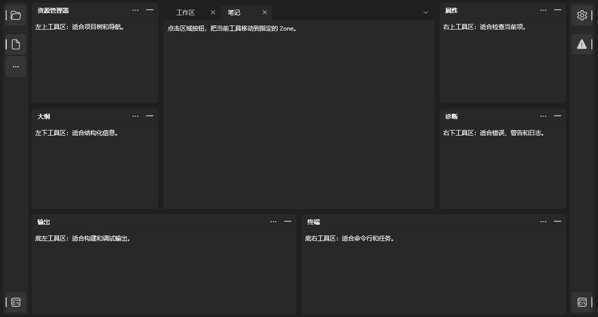

# WinUI.AvalonDock

[](https://www.nuget.org/packages/WinUI.AvalonDock)

A WinUI 3 port of [AvalonDock](https://github.com/Dirkster99/AvalonDock) for tabbed documents, dockable tools and floating windows. The project is unofficial and AI-maintained. Requires .NET 10 and Windows 10 build 19041 or later.

## Install and use

```shell
dotnet add package WinUI.AvalonDock --prerelease
```

```xml
<dock:DockingManager xmlns:dock="using:AvalonDock" xmlns:layout="using:AvalonDock.Layout">
    <layout:LayoutRoot>
        <layout:LayoutPanel Orientation="Horizontal">
            <layout:LayoutAnchorablePane DockWidth="240">
                <layout:LayoutAnchorable Title="Explorer" ContentId="explorer" Content="Tools" />
            </layout:LayoutAnchorablePane>
            <layout:LayoutDocumentPane>
                <layout:LayoutDocument Title="Editor" ContentId="editor" Content="Document" />
            </layout:LayoutDocumentPane>
        </layout:LayoutPanel>
    </layout:LayoutRoot>
</dock:DockingManager>
```

Bind collections with `DocumentsSource` and `AnchorablesSource`, or bind `DockLayout` to a `Dirkster.AvalonDock.Mvvm` 5.0.0 model. For XML persistence, use `Dirkster.AvalonDock.Serializer.Xml` 5.0.0 and give each item a unique, stable `ContentId`. `LayoutSerializationCallback` can supply missing content during restore.

## Samples and verification

The [samples](https://github.com/qian-o/WinUI.AvalonDock/tree/master/sources/Experiments) demonstrate classic docking (`Docking`), six-zone tool layouts (`ToggleDocking`), and model-driven layouts (`Mvvm`). From the repository root on Windows x64, run a sample or check the local NuGet package.

```powershell
dotnet run --project .\sources\Experiments\Docking\Docking.csproj
.\verification\PackageConsumer\Run-Checks.ps1
```





[Ms-PL license](https://github.com/qian-o/WinUI.AvalonDock/blob/master/LICENSE)
